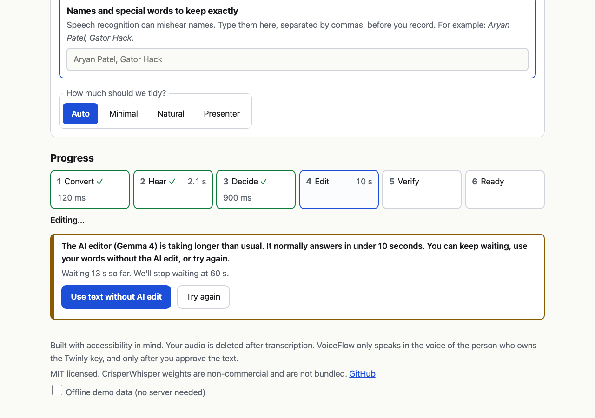

# VoiceFlow

**Speak naturally. Be heard clearly. Still sound like yourself.**

VoiceFlow takes a messy spoken recording (ums, repeats, "Friday, no wait, Monday"), shows you exactly what you said, proposes a cleaner version, checks that the meaning did not change, and only after you approve it speaks the result in your own cloned voice.

Built at UF Gator Hack V (Oct 23-25 2026).


*UI recorded in headless Chrome against `make mock` sample data; the audio in mock mode is a stand-in, not a cloned voice.*

## Why

Most people have said "um" on a stage. Presenters, students, non-native speakers and people with disfluencies sometimes want an *optional* tool that lets them speak their way and be understood the way they meant. Cleanup tools such as Descript and Cleanvoice already exist. VoiceFlow's focus is putting three things together in one flow:

1. **Transparent edits.** Your verbatim words (fillers kept) sit next to the rewrite, with a word-level diff and a reason for every change.
2. **A meaning guard.** Deterministic checks (numbers, days, names, negation, hedges, quantifiers, self-corrections) plus an AI second opinion. If the rewrite changes what you meant, it is blocked and the pipeline falls back toward your original words.
3. **Your own voice, with your approval.** Nothing is spoken until you approve the final text.

## How it works

```
 browser (static HTML + vanilla JS)
   | record / demo clip                         ^ SSE stage events (polling fallback)
   v                                            |
 FastAPI  /api/process ---> job store ---------- /api/jobs/{id}/events
   |
   +-- convert   ffmpeg -> 16 kHz mono wav
   +-- hear      CrisperWhisper: verbatim transcript (fillers kept)
   +-- decide    OpenAI Decisions API: filler / repetition / self-correction
   |             probabilities, register, recommended mode
   +-- edit      Gemma 4 via the Gemini API: minimal | natural | presenter
   +-- verify    meaning guard (rules + Decisions verifier)
   |             fallback ladder: full -> retry -> minimal -> original text
   v
 you approve the text  --->  /api/speak  --->  Twinly (your voice)  --->  audio chunks played in order
```

The browser only ever talks to this server. Twinly, OpenAI and Gemini are called from the backend, and keys stay in `.env`.

## Screenshots

| Ready: verbatim vs. rewrite, reasons, meaning check | Fallback explained in plain English |
|---|---|
|  |  |
| **Stuck stage: the page warns and offers a way out** | **Names check: ASR misheard a name** |
|  |  |
| **Meaning check blocks a wrong day** | **Twinly problem with exact fix steps** |
|  |  |

More in `docs/screenshots/` (dark theme, playback, hard stop, `job_unverified`).

## When things go wrong

Real APIs fail: on our real runs the AI editor returned 500s, answered after 16-45 s or not at all, the analysis service ran out of credits, and Twinly's voice engine needed a restart. VoiceFlow is built so you are never left guessing:

- **Never stuck.** The page runs its own watchdog. If the server goes quiet for 15 s, or a stage runs past twice its normal time, it says what is slow and offers **Use text without AI edit** (your transcript with only filler sounds removed) or **Try again**. At 60 s it stops waiting. Every request has a deadline.
- **Fallbacks explained.** If the AI edit fails or changes your meaning, the pipeline falls back (stricter retry, then filler-only, then your exact words), and a box says why and what was and wasn't changed. The trace panel turns errors like 401, 429, 500 or a timeout into short sentences, with the raw error one click away.
- **Twinly errors come with fix steps** (voice still starting, clone not built, app unreachable, rate limit). If Twinly can't confirm a line was spoken, speaking is locked for that recording so it is never sent twice.
- **Names.** Type names before recording. After processing, the Names check shows whether each was heard correctly, misheard (and as what), or kept in the final text, with a one-click fix.

The demo-day checklist is in [docs/RUNBOOK.md](docs/RUNBOOK.md).

## Quickstart

```bash
brew install ffmpeg     # needed on your PATH
make setup              # venv + dependencies; creates .env from .env.example if you have none
                        # then open .env and fill in your own keys
make warm               # one-time download of the speech-recognition weights
make mock               # try everything with recorded sample data, no keys needed
make run                # real services, http://localhost:8000
```

Open <http://localhost:8000> in **Chrome on desktop**. Press **Record** (or `Space`), or use **Use demo clip**. Microphone access needs `localhost` or https.

Frontend only, no server: open the page with `?mock=1` or tick "Offline demo data" in the footer. This runs a local simulation of the whole flow.

## Requirements

- macOS for speaking: the Twinly desktop app must be running and signed in, with a built voice clone and a Developer API key. Without it VoiceFlow still gives you the cleaned-up text; speaking is switched off and the page says so.
- Python 3.11+ and `ffmpeg` on your PATH.
- Keys in `.env`: `TWINLY_API_KEY`, `OPENAI_API_KEY` (Decisions API), `GEMINI_API_KEY` (Gemma 4 is called through the Gemini API).
- A modern Chrome. Firefox and Safari record in different formats and are untested.

## Accessibility

Built with accessibility in mind: system font, light and dark themes, visible focus rings, `Space` toggles recording, stage updates and warnings are announced through `aria-live`, and edits are shown with underline and strike-through as well as colour. What we actually checked, automatically in headless Chrome (`frontend/e2e/e2e.py`): a keyboard-only run from recording to playback; every visible text element is at least 18 px; and every visible text element has at least 4.5:1 contrast against its background, in both themes. We have not tested with a screen reader or with disabled users, and we make no WCAG conformance claim.

## Ethics

- Only the voice of the person who owns the Twinly key is ever used, behind Twinly's own consent gate. VoiceFlow cannot clone anyone else.
- Never auto-speaks: you approve the exact final text. If the meaning guard flags the text you must tick an explicit override.
- Generated audio is labelled **synthetic** in the UI.
- It is an optional assist, not a correction of how anyone should speak. Minimal mode keeps almost everything. We have not yet consulted people who stutter or other affected communities; that is a next step and we claim no endorsements.
- No medical or therapeutic claims.

## Privacy

Uploaded audio is deleted after transcription (unless the server is started with `KEEP_AUDIO=1`). Your recording in the browser stays in memory for "Play original recording" and is gone when you reload. Transcript text is sent to OpenAI (Decisions), Google (Gemini API) and Twinly (the approved text only) to do their jobs. API keys and audio payloads are never logged.

## Licence notes

VoiceFlow is MIT licensed (see `LICENSE`). **CrisperWhisper model weights are licensed non-commercially and are not bundled in this repository**; they are downloaded by the user on first run and remain under their own licence. Gemma 4 is used via the Gemini API under Google's terms. Check each dependency's licence before any commercial use.

## Limitations

- One voice (the key owner's), English only.
- Asynchronous: roughly 10-20 seconds from recording to approved text, plus voice generation time. Not live.
- Speaking needs a Mac running Twinly; Twinly output is capped at about 2400 characters per approval.
- The meaning guard is rule-based plus an AI judge. It is a safety net, not a proof; always read the text before approving.
- The "demo clip" is a computer-generated voice reading the canonical example, not a person (the demo speaker re-records it before finals; see the runbook).
- The guard can't see meaning changes that touch no number, date, name, negation, hedge or quantifier (for example swapping "major" and "minor"); only the AI verifier catches those, and it is offline when the Decisions API has no credits.

## Tests and evaluation

- **Backend unit tests:** `make test` (no network): 179 passed, 3 expected failures (2026-10-24).
- **Meaning guard, false positives and negatives:** `python eval/guard_eval.py` runs 67 cases (36 good rewrites, 31 bad ones) hand-written to look like Gemma output; they are not real model outputs. Result: **0/36 good rewrites wrongly blocked, 3/31 bad rewrites wrongly passed.** All three misses are content swaps with no fact signal (see Limitations).
- **Frontend:** `python frontend/e2e/e2e.py` drives the page in headless Chrome with a fake microphone against a deliberately misbehaving fake backend (`frontend/e2e/scenario_server.py`: hung stages, frozen polling, 401/429/500/timeout fallbacks, every Twinly error) and against the real backend in `MOCK=1`: 55/55 checks pass, including the keyboard-only run and the size/contrast audit. It also regenerates the screenshots and `docs/demo.gif`.
- **End-to-end pipeline eval** on `eval/utterances.json` with real APIs (`make eval`): pending; needs Gemma, Decisions credits and a ready Twinly voice. Results will go in `eval/RESULTS.md`.

## Fresh off the frontier

| Technology | Released | Role in VoiceFlow | One difficulty |
|---|---|---|---|
| OpenAI Decisions API | public beta Oct 6 2026 | routes and scores: edit predicates, mode, register; second-opinion verifier | our key had no credits (`429 credit_balance_exhausted`), so no success response was ever captured; health reported "ok" because it only checked that a key existed, until we added a real 1-question probe. Docs disagreed on the question limit (live validation errors settled it at 400 per call). Without it the guard runs its fixed rules only, and the UI says so |
| Gemma 4 (via Gemini API) | Apr 2 2026 | the edit engine, three modes | first key was the wrong type (`401 ACCESS_TOKEN_TYPE_UNSUPPORTED`). Later real calls took ~16 s on short input and 45 s once, ended in `500 INTERNAL`, or never answered; the team also saw long "thinking" output adding latency. Fix: 12 s per call, 20 s total, one retry on 500, then the fallback ladder; plus a client watchdog so the page never hangs |
| CrisperWhisper | arXiv 2607.18934, ~Jul 2026 (exact date to confirm) | verbatim ASR that keeps fillers | `transformers` 5.x breaks it, so it is pinned below 5; it misheard a name ("Ariane Patel" for "Aryan Patel"), which led to the protected-terms and Names check features; weights are non-commercial and not bundled |
| Twinly Developer API | release date to confirm | speaks the approved text in your own voice | errors such as `voice_not_set_up` and `voice_starting` arrive inside an HTTP 200 job body; `/me` can't tell whether the voice engine is running, and a failed `voice_starting` attempt takes ~43 s. The fix was to quit and reopen the Twinly app; retries are budgeted to fit a 60 s cap |

See `DIFFICULTIES.md` for the problems we hit.

## Project layout

`backend/` FastAPI app and pipeline stages · `frontend/` static page (`index.html`, `app.js`, `style.css`, `types.ts`, `mock-job.json`, `demo-clip.m4a`) and `frontend/e2e/` browser tests · `fixtures/` recorded responses for `MOCK=1` · `eval/` guard and pipeline evaluation · `tests/` · `docs/` design notes, screenshots and the demo-day runbook.

## Credits

Twinly, OpenAI, Google Gemma and CrisperWhisper for the models and APIs. Built with FastAPI, uvicorn, httpx, pydantic and ffmpeg; browser tests use Playwright. All project code was written during the hackathon window.
