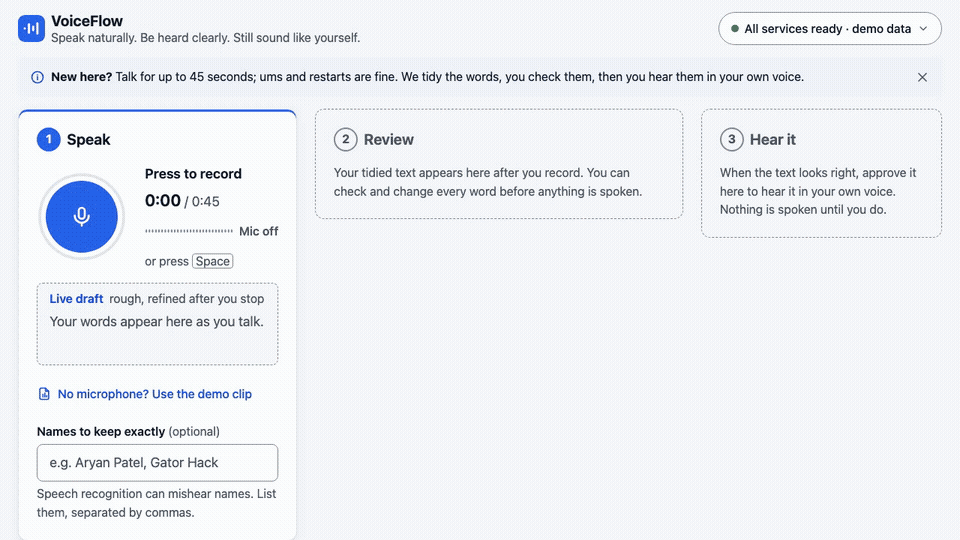
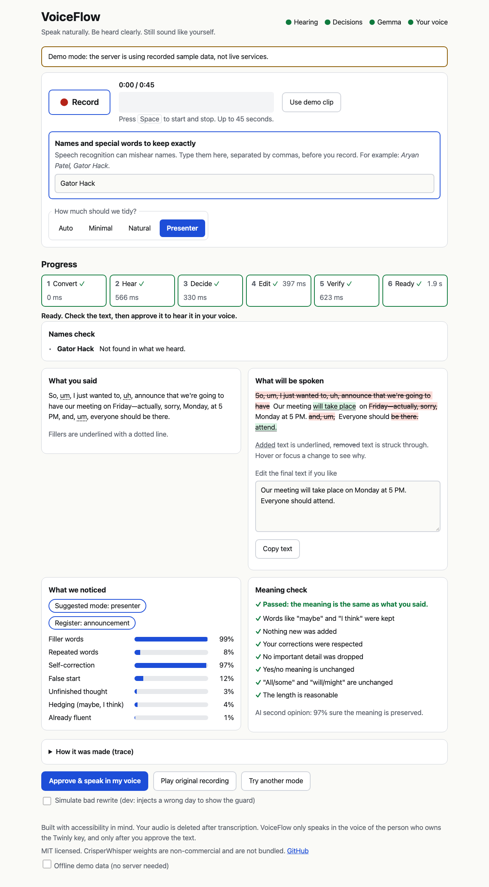
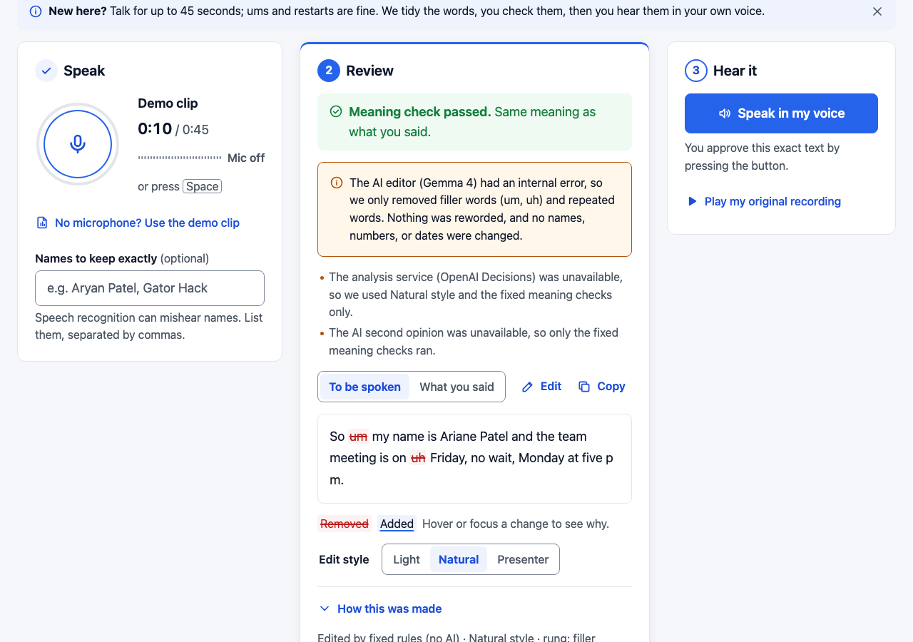
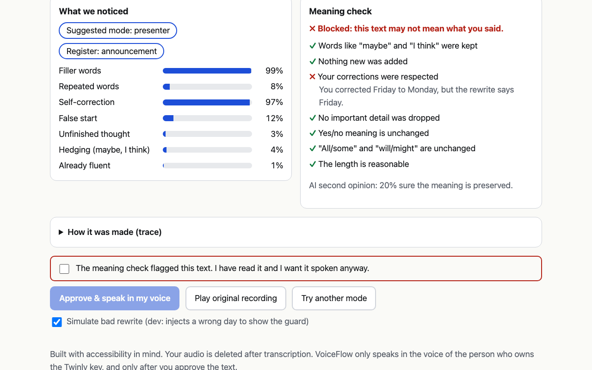
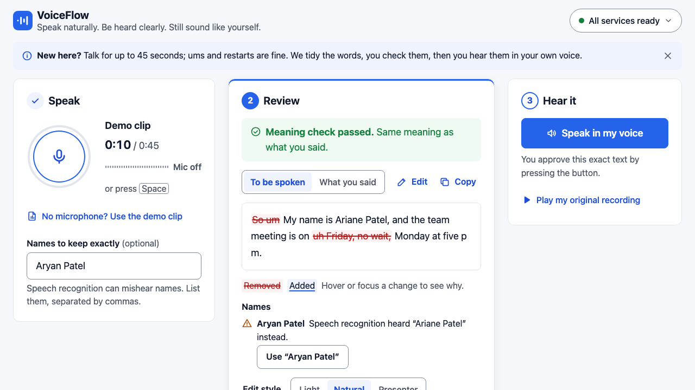
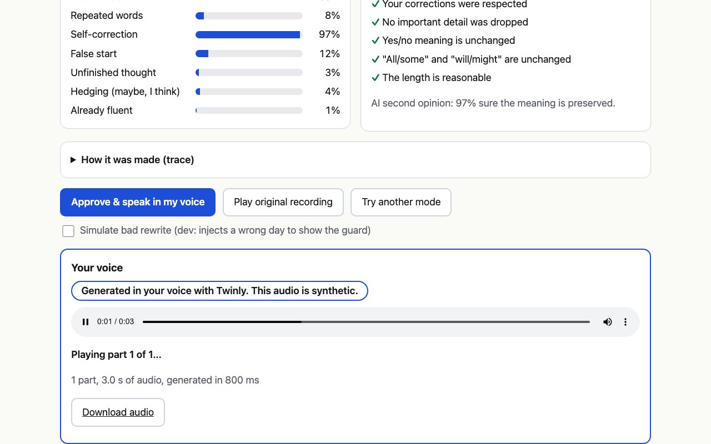
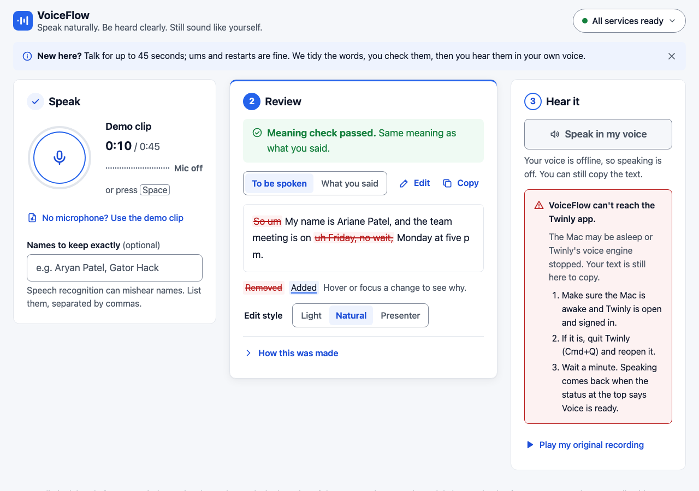

# VoiceFlow

**Speak naturally. Be heard clearly. Still sound like yourself.**

VoiceFlow takes a messy spoken recording (ums, repeats, "Friday, no wait, Monday"), shows you exactly what you said, proposes a cleaner version, checks that the meaning did not change, and only after you approve it speaks the result in **your own cloned voice**.

Built at UF Gator Hack V (Oct 23-25 2026). MIT licensed.



*The GIF is recorded in headless Chrome against `make mock` sample data. In mock mode the audio is `fixtures/backup_demo.m4a`: the canonical line rendered once by Twinly in the Mac owner's cloned voice.*

## Why

Most people have said "um" on a stage. Presenters, students, non-native speakers and people with disfluencies sometimes want an *optional* tool that lets them speak their way and be understood the way they meant. Cleanup tools such as Descript and Cleanvoice already exist. VoiceFlow puts three things together in one flow:

1. **Transparent edits.** Your verbatim words (fillers kept) next to the rewrite, with a word-level diff and a reason for every change.
2. **A meaning guard.** Deterministic checks (numbers, times, days, names, negation, hedges, quantifiers, self-corrections, dropped or added phrases, swapped roles) plus an AI second opinion. If the rewrite changes what you meant, it is blocked and the pipeline falls back toward your own words.
3. **Your own voice, with your approval.** Nothing is spoken until you approve the final text, and the audio is labelled synthetic.

## How it works

The page has three steps, always visible: **1 Speak** (record, with a live draft transcript), **2 Review** (verbatim vs. edit, reasons, meaning check, editable text), **3 Hear it** (approve, then play in your voice).

```
 browser (static HTML + vanilla JS)
   | record / demo clip        live draft: POST /api/live every ~3 s while recording
   v                                              ^ SSE stage events (polling fallback)
 FastAPI  /api/process ---> job store ---------- /api/jobs/{id}/events
   |
   +-- convert   ffmpeg -> 16 kHz mono wav
   +-- hear      CrisperWhisper (local): verbatim transcript, fillers kept
   +-- mode      Auto uses Natural; no blocking style analysis
   +-- edit      Gemma 4 via the Gemini API: minimal | natural | presenter
   +-- verify    meaning guard: deterministic rules + Decisions verifier
   |             fallback ladder: Gemma -> stricter Gemma retry ->
   |             verified deterministic edit -> hesitation removal -> original text
   v
 you approve exact revision --> /api/speak/async --> Twinly API --> Twinly app on your Mac (cloned voice)
                                                    --> m4a chunks, cached by text hash, played in order
```

The browser only talks to this server. Twinly, OpenAI and Gemini are called from the backend; keys stay in `.env`. Every stage writes a trace entry that the page shows ("How this was made").

## Screenshots

| Review: verbatim vs. edit, reasons, meaning check | Fallback explained in plain English |
|---|---|
|  |  |
| **Meaning check blocks a wrong day** | **Names check: ASR misheard a name** |
|  |  |
| **Hear it: playing in your voice** | **Twinly problem with exact fix steps** |
|  |  |

More in `docs/screenshots/`. They are regenerated by `python frontend/e2e/e2e.py`.

## When things go wrong

On our real runs the AI editor returned 500s, took 16-45 s or ran out of credits, the analysis service had no credits, and Twinly's voice engine needed a restart and crashed when given two lines at once. VoiceFlow is built so you are never left guessing:

- **Never stuck.** The page runs its own watchdog: after 15 s without progress, or a stage running past twice its normal time, it says what is slow and offers **Use text without AI edit** or **Try again**; at 60 s it stops waiting. The server has its own 90 s job deadline, and every request has a timeout.
- **Fallbacks explained.** Substantive edits need an independent verifier, including in fast mode. When it is unavailable, VoiceFlow keeps the original wording and only removes hesitation sounds; self-corrections may remain. Light mode performs this local cleanup without model calls.
- **Honest health.** `/api/health` reports each service as ok, no credits or auth error from the last real call (a key that exists is not "ok"), and the page shows it.
- **Twinly errors come with fix steps** (voice still starting, clone not built, app unreachable, rate limit). A `503 job_unverified` is never retried and speaking is locked for that recording, so a line is never paid for or spoken twice. Lines render one at a time (two at once crashed Twinly's engine); a render that outlives the 60 s request cap still lands in the cache, so pressing speak again plays it at no extra cost.

The demo-day checklist is [docs/RUNBOOK.md](docs/RUNBOOK.md).

## Quickstart

```bash
brew install ffmpeg     # needed on your PATH
make setup              # venv + dependencies; creates .env from .env.example if you have none
                        # then fill in your own keys in .env
make warm               # one-time download of the speech-recognition weights
make mock               # everything stubbed with recorded sample data, no keys needed
make run                # real services, http://localhost:8000
make smoke              # in another terminal: 5 real runs of the demo clip (SPEAK=1 adds one paid Twinly line)
make test               # unit tests, no network
```

Open <http://localhost:8000> in **Chrome on desktop**. Press **Record** (or `Space`), or **Use demo clip**. Microphone access needs `localhost` or https.

## Requirements

- **macOS 26 or newer on Apple silicon, for speaking.** Twinly renders the voice locally in its MLX voice engine. On macOS 15 the engine bundled with Twinly 4.2.1 (MLX 0.31.2) could not load its models: `Failed to load the default metallib ... language version 4.0`, i.e. its Metal shaders need a newer OS. After updating to macOS 27.0.1 it loaded and spoke (see `DIFFICULTIES.md`). Check it with `curl -s http://127.0.0.1:4807/health`.
- The Twinly desktop app (4.1.2+) running and signed in, a built voice clone, and a Developer API key with credits. Without Twinly you still get the cleaned-up text; speaking is switched off and the page says so.
- Python 3.11+ (we ran 3.13) and `ffmpeg` on your PATH.
- Keys in `.env` (see `.env.example`): `TWINLY_API_KEY`, `OPENAI_API_KEY` (Decisions API), `GEMINI_API_KEY` (Gemma 4 is called through the Gemini API).
- Chrome. Firefox and Safari record in other formats and are untested.

## Evaluation

Full tables, raw rows and what was offline: [eval/RESULTS.md](eval/RESULTS.md) (2026-10-24). Summary:

- **Online during the runs:** CrisperWhisper, the meaning guard, the deterministic edit, Twinly. **Offline:** Gemma 4 (`402` no credits on every call) and the Decisions API (`429` no credits). So every output came from the fallback ladder, not Gemma, and the AI verifier did not run. The results measure the ladder and the guard, not Gemma's editing.
- **Text eval, 8 utterances x 3 modes (n=24):** must-keep facts kept 24/24; must-drop 22/24 (both misses are Minimal mode keeping a superseded "Friday", which the guard then blocks, falling back to the original). Fillers 36 -> 4. Rungs: deterministic 22, original 2, Gemma 0.
- **Real audio through the real server (n=3):** all 3 jobs reached ready in 2.0-3.1 s with the guard passing; "Friday at five PM no wait sorry Monday at five PM" became "Monday at five PM".
- **Meaning guard, 80 labelled rewrites:** 0/44 good rewrites blocked, 1/36 bad rewrites passed. On 13 held-out cases written before tuning: 0/8 and 2/5. The cases are hand-written, so read these as "no known false positives", not a rate.
- **Twinly, real calls (n=8 renders):** a short line takes 4-8 s; a 1,172-char text (3 chunks, 57 s of audio) took 28.6 s, in order; repeating it was a cache hit in 10 ms with no spend.
- **Tests:** `make test`: 274 passed, 1 expected failure (a known guard false negative), 2026-10-24.
- **Not done yet:** Gemma and Decisions quality (needs credits), teammates rating "sounds like me".

## Fresh off the frontier

| Technology | Public since | Role in VoiceFlow | What was hard |
|---|---|---|---|
| OpenAI Decisions API | public beta Oct 6 2026 | calibrated probabilities for routing (filler, self-correction, register, mode) and a second-opinion meaning verifier | the key never had credits (`429`), so no success response was ever captured. Free validation errors settled the question limit (400 per call) and schema. Health first said "ok" because it only checked a key existed |
| Gemma 4 via the Gemini API | Apr 2 2026 | the edit engine, three modes, with edit reasons | first key was the wrong type (`401`), then real calls took ~16 s, once 45 s, or ended in `500`, then `402` credits depleted (first treated as a rate limit and retried). Fix: 12 s per call, 20 s total, no retry on 401/402/403, the fallback ladder, and rule-based self-correction so a Gemma outage still fixes "Friday, no wait, Monday" |
| CrisperWhisper 2.0 (Nyra Labs, `crisperwhisper` 2.0.3) | 2026 (exact date to confirm) | verbatim ASR that keeps um/uh and false starts, with word timings | `transformers` 5.x broke word timestamps (pinned `<5`); it heard "Ariane Patel" for "Aryan Patel", which led to the names field and Names check; live drafts re-transcribe the whole clip, so they skip word timestamps to stay under ~2 s |
| Twinly Developer API (`/v1/voice/speak`) | 2026 (exact date to confirm) | speaks the approved text in the key owner's own cloned voice, rendered on their Mac | errors arrive inside HTTP 200 job bodies (`voice_not_set_up`, `voice_starting` after ~43 s); the voice engine needed macOS 26+; two concurrent jobs crashed the engine (`There is no Stream(gpu, 12) in current thread`), so lines render one at a time |

Details in [DIFFICULTIES.md](DIFFICULTIES.md).

## Ethics

- Only the voice of the person who owns the Twinly key is used, behind Twinly's own setup and consent on their Mac. VoiceFlow cannot clone anyone else.
- Never auto-speaks: you approve the exact final text. If the meaning guard flags it you must tick an explicit override.
- Generated audio is labelled **synthetic**.
- An optional assist, not a correction of how anyone should speak. Minimal mode keeps almost everything. We have not consulted people who stutter or other affected communities yet; that is a next step, and we claim no endorsements.
- No medical or therapeutic claims.

## Privacy

Uploaded audio is deleted after transcription (unless started with `KEEP_AUDIO=1`); ASR runs locally. The browser keeps your recording in memory for "Play original" until you reload. Transcript text goes to OpenAI (Decisions) and Google (Gemini API), and only the approved text goes to Twinly. Generated voice audio and paid-request journals are cached in `cache/` (gitignored). Uncertain submissions are not automatically resent. Do not delete request journals or caches to retry uncertain paid requests; reconcile them with Twinly first. Keys and audio payloads are never logged.

## Licence notes

VoiceFlow is MIT licensed (`LICENSE`). **CrisperWhisper model weights are under a non-commercial licence and are not bundled**; they are downloaded on first run (`make warm`) and stay under their own licence. Gemma 4 is used through the Gemini API under Google's terms; Twinly and OpenAI under their API terms. `fixtures/backup_demo.m4a` is the team member's own cloned voice, included with their consent for the demo fallback. Check each dependency's licence before any commercial use.

## Limitations

- One voice (the key owner's), English only, macOS 26+ for speech.
- Asynchronous: a few seconds to the reviewed text with the fallback rung (Gemma adds ~10-20 s when it works), then 4-8 s per short line of voice. Not real-time.
- Text to speak is capped at 2,400 characters. Longer texts (5 chunks at ~14 s each) can pass the 60 s speak cap; the renders continue and pressing speak again plays them from cache.
- The meaning guard is a safety net, not a proof. Known gap: a role swap that keeps the same words in the same order ("A will review B's proposal" -> "B will review A's proposal") passes the deterministic rules; only the AI verifier would catch it. Always read the text before approving.
- Without an independent verifier, cleanup is limited to hesitation sounds; repetitions and self-corrections remain. Natural and Presenter may make substantive deletions only with verification. Automatic paraphrases and word reordering are rejected.
- The "Use demo clip" button plays a macOS `say` voice reading the canonical example, not a person.

## Project layout

`backend/` FastAPI app and one module per stage (`asr`, `decide`, `rewrite`, `guard`, `voice`, `split`) · `frontend/` static page and `frontend/e2e/` browser tests · `fixtures/` recorded real responses (`real_*.json`) and `MOCK=1` data · `eval/` pipeline eval, guard corpus, `RESULTS.md` · `scripts/smoke.py` · `tests/` · `docs/` design notes, screenshots, runbook, Devpost draft.

## Credits

Twinly (voice cloning API and Mac app), OpenAI (Decisions API), Google (Gemma 4, Gemini API), Nyra Labs (CrisperWhisper). Built with FastAPI, uvicorn, httpx, pydantic, google-genai, openai, transformers and ffmpeg; browser tests use Playwright. The Twinly client was written from the public docs, not from the example repo. All project code was written during the hackathon window.

## Optimization validation

The `rohit-optimize` changes and measured tradeoffs are documented in [the optimization report](docs/OPTIMIZATION_2026-10-24.md). Controlled local pipeline latency improved by 35.7%; this is not a live paid-provider benchmark. Run `make test` for the offline Python and frontend regression suites.
